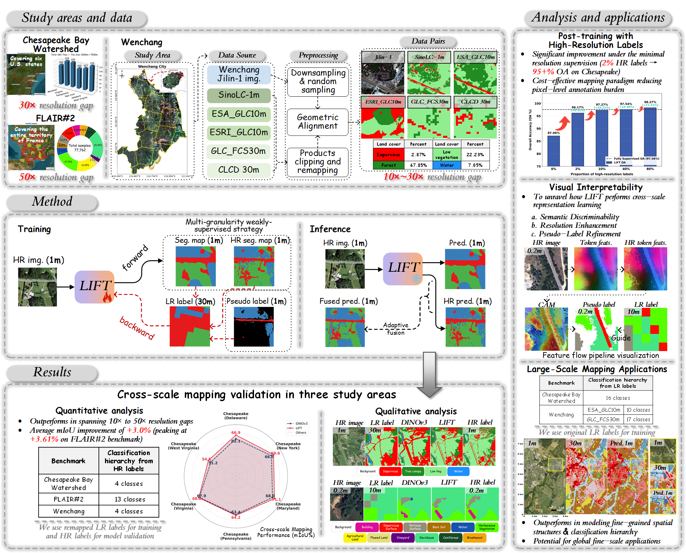

# Foundation Model Driven Land Cover Mapping: Enhancing High-Resolution Mapping with Low-Resolution Guidance

    

An overview of the paper, covering the study areas and data, proposed method, validations
across multiple study areas, as well as corresponding analyses and applications.
